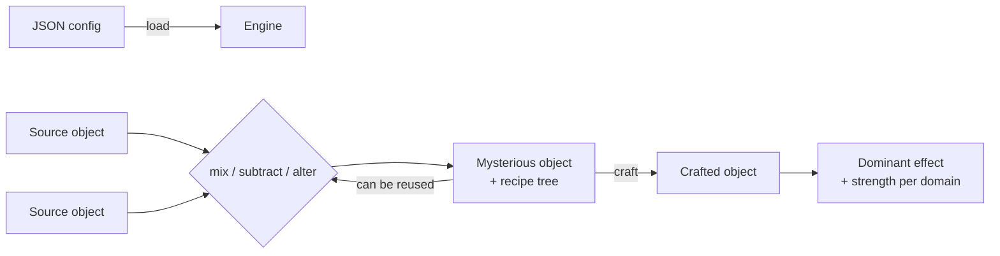

# Potion Crafting Engine

**A data-driven C++17 library for alchemy and crafting mechanics: mix ingredients, transform them, and resolve what effect the result produces. It is built to plug into Unity, Unreal, or Godot through a stable C API.**


The engine owns the **rules and the math**. The game owns the **state, UI, and story**. A completely different crafting system can be created just by writing a new JSON config, with no engine code changes.

---

## Features

- **Data-driven**: domains, effects, ingredients, and transformations all live in a JSON config, validated on load.
- **Composable operations**: `mix` (add / multiply N ingredients), `subtract`, and `alter` (modular exponentiation), with results always kept inside `[0, modulus-1]`.
- **Effect resolution**: a deterministic dominance algorithm picks between *pure* (single-domain) and *combined* (multi-domain) effects, with tunable rarity through capture radii and a β threshold.
- **Full recipe history**: every result carries the operation tree that produced it, so games can show, save, or replay how a potion was made.
- **Engine-agnostic**: a C API with opaque handles is exported from a shared library (`.dylib` / `.so` / `.dll`) for FFI from C#, C++, or GDScript bindings.
- **Cross-platform releases**: GitHub Actions builds the library for macOS (universal arm64 + x86_64), Linux, and Windows on every version tag.

## How it works



Every ingredient is a set of **domains**, and each domain is a point in 3D space (`[x, y, z]`, modulo a prime). Effects are **anchors** in that space with a capture radius. Crafting finds which anchors the result falls near and decides the winner. The structure is opaque at first, but players can learn it through experimentation.

## Quick example

```cpp
#include "effect_engine/engine.h"
#include <iostream>

using namespace effect_engine;

int main() {
    Engine engine;
    engine.load("project_context/tea_alchemist_config-v1.0.0.json");

    SourceObject chamomile = engine.getSourceObjectInfo("chamomile", "standard");
    SourceObject ginger    = engine.getSourceObjectInfo("ginger", "standard");

    // Combine ingredients, then transform the result.
    MysteriousObject brew    = engine.mix({chamomile.clone(), ginger.clone()}, "add");
    MysteriousObject altered = engine.alter(brew, "fire_focus");

    // Resolve the dominant effect.
    CraftedObject result = engine.craft(altered);
    if (result.effect.effectId.empty()) {
        std::cout << "No effect: the brew landed in a dead zone.\n";
    } else {
        std::cout << result.effect.effectId
                  << " (strength " << 1.0f - effectDistance(result.effect) << ")\n";
    }
}
```

A config is just JSON. Here is part of the sample [`tea_alchemist_config-v1.0.0.json`](project_context/tea_alchemist_config-v1.0.0.json):

```json
{
  "engine": { "modulus": 7 },
  "domains": { "leaf": { "display_name": "Leaf" }, "root": { "display_name": "Root" } },
  "effects": {
    "pure": {
      "calming_brew": { "domain": "leaf", "anchor": [5, 2, 4], "capture_radius": 2.0 }
    }
  },
  "source_objects": {
    "chamomile": { "tiers": { "standard": [[4, 2, 3], [1, 5, 2]] } }
  },
  "alter_objects": {
    "fire_focus": { "exponents": [1, 5] }
  }
}
```

## Building

**Requirements:** CMake ≥ 3.16, a C++17 compiler, and [nlohmann/json](https://github.com/nlohmann/json).

```bash
# macOS
brew install cmake nlohmann-json
# Ubuntu / Debian
sudo apt-get install cmake nlohmann-json3-dev

cmake -B build -DCMAKE_BUILD_TYPE=Release
cmake --build build --config Release
```

This produces:

| Target | Description |
| --- | --- |
| `effect_engine` | Static C++ library |
| `effect_engine_c` | Shared library exposing the C API (for game engines) |
| `tea_alchemist` | Test suite for the C++ API |
| `c_api_smoke` | End-to-end smoke test through the C API only |

Run the tests from the repository root. Use a Debug build, because the tests use `assert`, which Release builds disable:

```bash
cmake -B build-debug -DCMAKE_BUILD_TYPE=Debug && cmake --build build-debug
./build-debug/tea_alchemist && ./build-debug/c_api_smoke
```

Prebuilt libraries for each platform are attached to every [GitHub Release](../../releases).

## Using it from a game engine

The C API ([`effect_engine_c.h`](include/effect_engine/effect_engine_c.h)) uses **opaque handles** owned by the caller and paired `*_free` functions, so no C++ types or struct layouts cross the ABI boundary.

- [Concepts: connecting any game engine](project_context/game_engine_integration.md)
- [Unity setup (C# / P/Invoke)](project_context/setup_unity.md)
- [Unreal setup (C++ subsystem)](project_context/setup_unreal.md)

## Project structure

```
include/effect_engine/   Public headers (C++ API, C API, config types)
src/                     Engine, config loader, C API, and tests
project_context/         Design documents, setup guides, sample config
.github/workflows/       Cross-platform build and release pipeline
```

## Design decisions

- **A C API on top of the C++ core.** C++ has no stable ABI across compilers, but every engine (and C#, through P/Invoke) can call C. Only the `extern "C"` symbols are exported; everything else is built with hidden visibility.
- **Stateful about config, stateless about game objects.** The engine holds the immutable config. Ingredients are value objects that the game stores and passes back, so saving and loading belongs entirely to the game.
- **Modulus after every operation.** Values never grow without bounds, so every intermediate result is a valid ingredient and can be inspected, stored, or mixed again.
- **Prime modulus and bounded exponents.** Alter exponents are limited to `[1, modulus-2]` because, by Fermat's Little Theorem, larger exponents would duplicate smaller ones.
- **Fixed ingredient values per tier.** Values are learnable, not procedural, so players can build a mental model and share discoveries.

The full reasoning, formulas, and trade-offs are in the design documents:

- [Effect System Design](project_context/effect_system_design.md): the math and the dominance algorithm
- [Engine Architecture & Design Decisions](project_context/effect_engine_architecture.md): layers, API, config schema, and open questions

<!-- TODO (Kim): write this section yourself — 3 honest bullets about what you learned
     building this (e.g. designing a C ABI, polymorphism with shared_ptr, CMake, CI). -->
## What I learned

- **Designing a library, not just a program.** I split the engine into a C++ core and a C API
  that exports only `extern "C"` functions with opaque handles, then integrated it into Unity
  (P/Invoke) and packaged it as a Godot GDExtension — learning why C is the shared language
  between engines and why memory ownership must be explicit across that boundary.
- **Recursive trees and object lifetime.** Each crafted result carries a recipe tree of
  operations. Building it taught me why polymorphic types need a virtual `clone()`: copying
  through the base class slices off the subtree, and pointing to the original risks dangling
  pointers.
- **Turning math into game design.** What began as curiosity about prime numbers, modular
  inverses, and modular arithmetic became the core of the system: ingredients as overlapping
  3D cubes modulo a prime, with Fermat's Little Theorem used to keep the item catalog free of
  hidden duplicates.
- **Cross-platform builds.** This was my first project on macOS. I learned CMake beyond Visual
  Studio and set up GitHub Actions to build and release the library for macOS, Linux, and Windows.
- **Code review and AI tools.** For the first time, my changes were read by a reviewer, which
  changed how I write and explain code. I also used AI assistants to move faster, while
  verifying their suggestions with tests and questioning code that looked unnecessary.

## License

Released under the [MIT License](LICENSE).
